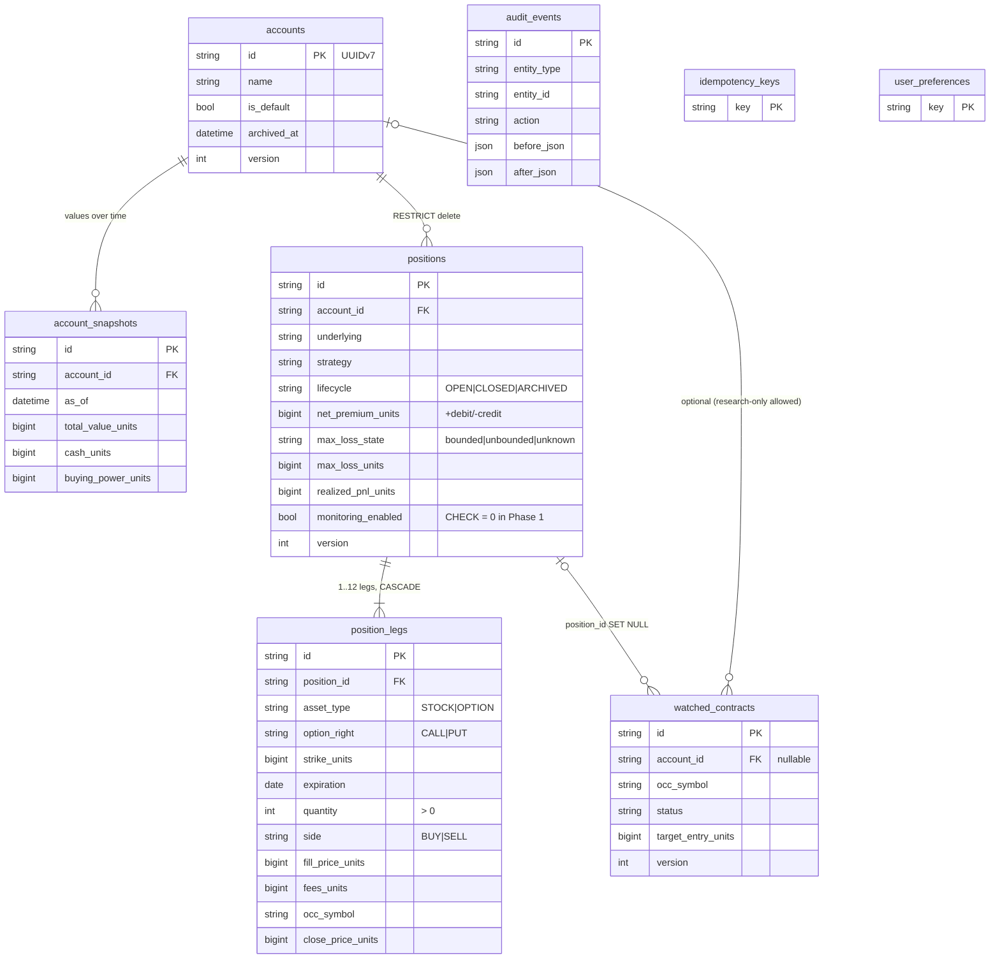

# optlab architecture

optlab is two applications over one project folder:

| | Dashboard (new, primary) | Research Lab (original) |
|---|---|---|
| What | Accounts, positions, legs, watched contracts, strategy analysis | Watchlist, market, option chains, backtests, Signal explorer, overlay |
| Stack | FastAPI + SQLAlchemy 2 + Alembic, React 19 + TypeScript + Vite | Streamlit |
| Data | `data/optlab.sqlite` (SQLite, WAL) | `data/market.duckdb`, `data/history.duckdb` (DuckDB) |
| Port | 127.0.0.1:8600 | 127.0.0.1:8517 (systemd) / 8518 (Docker) |
| Code | `src/optlab/portfolio`, `src/optlab/api`, `web/` | `app/`, `src/optlab/{data,live,overlay,history,...}` |

Nothing in either application places orders or connects to a broker's order entry.

```
 browser ──HTTPS (Tailscale)──▶ :8600  FastAPI ──┬─ /api/v1/*  routes.py ─▶ portfolio.service ─▶ SQLite (optlab.sqlite)
                                                  │                         │
                                                  │                         ├─ recognize.py  (strategy + exact payoff maths)
                                                  │                         └─ quotes.py     (shared chain snapshots) ─▶ Cboe via OpenBB
                                                  └─ /*  web/dist (React)                                (DuckDB: earnings dates, read-only)
 browser ──HTTPS :8443 (Tailscale)──▶ :8517  Streamlit Research Lab ─▶ DuckDB
 systemd: optlab-monitor (scans.yaml, unchanged), optlab-ingest timer (DuckDB, unchanged)
```

## Backend layers (`src/optlab/portfolio`, `src/optlab/api`)

| Module | Responsibility |
|---|---|
| `money.py` | Exact money: persisted as integer $0.0001 units; inputs with more than 4 decimals rejected; computed values rounded half-even once |
| `ids.py` | UUIDv7 primary keys (RFC 9562; internal implementation, tested) |
| `occ.py` | OCC option symbols (build/parse) |
| `models.py` | SQLAlchemy models, constraints, optimistic-concurrency `version` |
| `db.py` | Engine (WAL, foreign keys, busy timeout, BEGIN IMMEDIATE for writes), forward migrations under a file lock, online backup, single-instance lock |
| `recognize.py` | Deterministic strategy recognition and exact analytics (max gain/loss, breakevens, buying-power effect) |
| `quotes.py` | One shared quote/chain snapshot service: TTL cache, single flight per symbol, provider + fetch timestamps, freshness labels, synthetic isolation |
| `valuation.py` | On-demand position valuation from the quote service (labelled ESTIMATED) |
| `service.py` | Domain operations: accounts, positions (create, edit, close, archive), contracts, preferences, audit, idempotency |
| `csv_import.py` | CSV preview/commit (atomic) and export (formula-safe) |
| `schemas.py` | Typed request/response models (pydantic v2) |
| `api/main.py`, `routes.py`, `deps.py`, `serialize.py` | FastAPI app factory, structured errors, CORS, static frontend, one transaction per request |

All financial calculations happen on the server; the browser formats strings for display.

## Database (Phase 1, migration `0001`)



Every table that records facts carries `created_at`, `updated_at`, `source`, `source_timestamp` and
`metadata_json`; editable ones carry `version`. Indexes: account, underlying, lifecycle, expiration,
OCC symbol, status, `(entity_type, entity_id, at)` on the audit log, and every foreign key.

## Request flow (create a position)

1. `POST /api/v1/positions` with an `Idempotency-Key`. A repeat with the same key returns the first response.
2. The schema validates types, decimal precision and timezones; a write session opens with `BEGIN IMMEDIATE`.
3. `recognize.analyze` classifies the legs and computes the risk; errors become `422` field errors; an
   unbounded/unknown maximum loss needs `acknowledge_risk`.
4. The position, its legs and an `audit_events` row are written; the transaction commits.

## Phase boundaries

- The live monitor (`scripts/monitor.py`) still reads only `scans.yaml`. Database positions have
  `monitoring_enabled = 0`, enforced by a CHECK constraint that the Phase 2 migration will lift.
- Lifecycle is OPEN / CLOSED / ARCHIVED only; HOLD / WATCH / ACTION REQUIRED / STALE DATA come with
  monitoring in Phase 2.
- `QuoteService` is built for reuse by the monitor in Phase 2; the monitor is unchanged in Phase 1.
