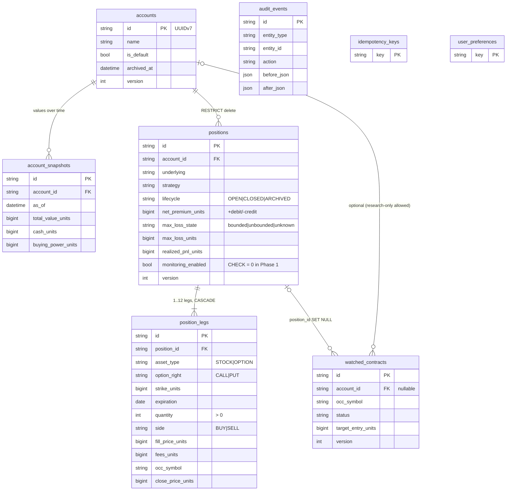
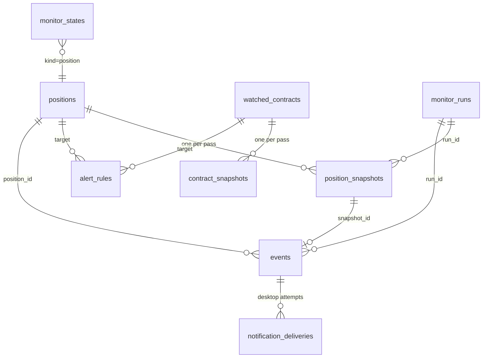

# optlab architecture

optlab is two applications over one project folder:

| | Dashboard (new, primary) | Research Lab (original) |
|---|---|---|
| What | Accounts, positions, legs, watched contracts, strategy analysis, position monitoring, alerts and events | Watchlist, market, option chains, backtests, Signal explorer, overlay |
| Stack | FastAPI + SQLAlchemy 2 + Alembic, React 19 + TypeScript + Vite | Streamlit |
| Data | `data/optlab.sqlite` (SQLite, WAL) | `data/market.duckdb`, `data/history.duckdb` (DuckDB) |
| Port | 127.0.0.1:8600 | 127.0.0.1:8517 (systemd) / 8518 (Docker) |
| Code | `src/optlab/portfolio`, `src/optlab/monitoring`, `src/optlab/api`, `web/` | `app/`, `src/optlab/{data,live,overlay,history,...}` |

Nothing in either application places orders or connects to a broker's order entry.

```
 browser ──HTTPS (Tailscale)──▶ :8600  FastAPI ──┬─ /api/v1/*  routes.py ─▶ portfolio.service ─▶ SQLite (optlab.sqlite)
                                                  │                         │
                                                  │                         ├─ recognize.py  (strategy + exact payoff maths)
                                                  │                         └─ quotes.py     (shared chain snapshots) ─▶ Cboe via OpenBB
                                                  └─ /*  web/dist (React)                                (DuckDB: earnings dates, read-only)
 browser ◀─SSE /api/v1/stream── events + finished passes (live updates)
                    API process: background thread  monitoring.runner ─▶ monitoring.engine ─▶ quotes.py (same snapshots)
                                                                         └─▶ snapshots, state, events ─▶ SQLite
                                                                         └─▶ notify-send (desktop)
 browser ──HTTPS :8443 (Tailscale)──▶ :8517  Streamlit Research Lab ─▶ DuckDB
 systemd: optlab-monitor (scans.yaml scans + YAML positions not imported), optlab-ingest timer (DuckDB, unchanged)
```

## Backend layers (`src/optlab/portfolio`, `src/optlab/api`)

| Module | Responsibility |
|---|---|
| `money.py` | Exact money: persisted as integer $0.0001 units; inputs with more than 4 decimals rejected; computed values rounded half-even once |
| `ids.py` | UUIDv7 primary keys (RFC 9562; internal implementation, tested) |
| `occ.py` | OCC option symbols (build/parse) |
| `models.py` | SQLAlchemy models, constraints, optimistic-concurrency `version` |
| `db.py` | Engine (WAL, foreign keys, busy timeout, BEGIN IMMEDIATE for writes), forward migrations under a file lock, online backup, single-instance lock |
| `recognize.py` | Deterministic strategy recognition and exact analytics (max gain/loss, breakevens, buying-power effect) |
| `quotes.py` | One shared quote/chain snapshot service: TTL cache, single flight per symbol, provider + fetch timestamps, freshness labels, synthetic isolation |
| `valuation.py` | On-demand position valuation from the quote service (labelled ESTIMATED) |
| `service.py` | Domain operations: accounts, positions (create, edit, close, archive), contracts, preferences, audit, idempotency |
| `csv_import.py` | CSV preview/commit (atomic) and export (formula-safe) |
| `schemas.py` | Typed request/response models (pydantic v2) |
| `api/main.py`, `routes.py`, `deps.py`, `serialize.py` | FastAPI app factory, structured errors, CORS, static frontend, one transaction per request |

All financial calculations happen on the server; the browser formats strings for display.

## Monitoring layer (`src/optlab/monitoring`, Phase 2)

| Module | Responsibility |
|---|---|
| `settings.py` | Monitor settings (schedule, confirmation, re-arm, repeat, stale limit, default rules, notifications), stored in `user_preferences`; seeded from scans.yaml until first saved |
| `calendar.py` | Monitoring window: weekly schedule in its time zone (DST via zoneinfo), US market holidays and early closes for 2026–2027 |
| `rules.py` | Conditions in the scans.yaml expression language; three-valued results (true / false / unknown) with the values used; completed-bar handling; validation per target (position / contract / symbol) |
| `status.py` | Position metrics, built-in action checks, status precedence STALE > EXIT > ACTION > WATCH > HOLD and the reason strings |
| `transitions.py` | Pure state machines: status confirmation (stale immediate), urgent reminders; alert fire / clear / re-arm / repeat |
| `events.py` | Writing events, the notification policy (severity, quiet hours, mutes), desktop delivery and its log |
| `engine.py` | One pass: read (short transaction) → fetch chains, bars, earnings (no lock held) → evaluate → write snapshots, state and events (one transaction) → notify |
| `runner.py` | The scheduler thread and the per-database monitor lock (`optlab.monitor.lock`): one monitor per database across processes and containers |
| `read.py` | Effective status for the API: closed, not monitored, never checked, and the stale overlay when the last check is older than the limit |
| `legacy.py` | scans.yaml import (with fingerprints) and the skip list the YAML monitor reads |
| `api/monitor_routes.py` | `/monitor/*`, `/events`, `/alert-rules`, position snapshots / timeline / rules, scans.yaml import, `/stream` (SSE) |

Each pass fetches one chain per underlying through the API's `QuoteService`, so the monitor and the
dashboard share snapshots and never fetch the same chain twice within its TTL. Price bars are fetched only
for rules that use studies. The monitor's per-pass state lives in `monitor_states`, not on the versioned
rows, so a pass never causes an edit conflict (except a watched contract whose status the monitor changes,
which is a real change). The live stream polls the `events` table by its sequence number, so it works
whichever process wrote the events, and a reconnecting browser resumes with `Last-Event-ID` without gaps.

## Database (Phase 1, migration `0001`)



Every table that records facts carries `created_at`, `updated_at`, `source`, `source_timestamp` and
`metadata_json`; editable ones carry `version`. Indexes: account, underlying, lifecycle, expiration,
OCC symbol, status, `(entity_type, entity_id, at)` on the audit log, and every foreign key.

## Planning layer (`src/optlab/planning`, Phase 3)

| Module | Responsibility |
|---|---|
| `policy.py` | Policy settings (money as exact decimal strings), small-account limits merged by strictness (`effective`), revisions in `risk_policies` |
| `riskcheck.py` | Candidate (legs or plan) and portfolio state → checks with PASS / WARNING / BLOCKED / UNKNOWN, value, limit and source; account utilization for the dashboard and events |
| `plans.py` | Plan fields, checklist validation, the state machine, risk assessment, conversion with the planned-versus-actual comparison, duplication |
| `monitor.py` | Called by the monitoring pass: trigger / confirmation / invalidation / expiry for plans; risk-limit events |
| `schemas.py` | API models for plans and policies |
| `api/plan_routes.py` | `/plans`, `/accounts/{id}/risk-policy`, `/accounts/{id}/risk`, `/risk/evaluate` |

Recording a position (`POST /positions`, CSV excluded) and converting a plan run the same check; the result
is stored on the position (`entry_risk_json`, `rule_violation`). The portfolio state comes from the
database (latest account values, open positions, positions closed today and this week) and the monitor's
latest fresh snapshots (open P&L, Greeks), never from a fresh network call.

## Process layer (`src/optlab/process`, Phase 4)

| Module | Responsibility |
|---|---|
| `engine.py` | Versioned rules (`process-score/v1`, `points-policy/v1`, `achievement-rules/v1`). Loads an account's facts once; `day_snapshot` (the evidence: ids and booleans) → `evaluate` (pure: MET / VIOLATED / UNKNOWN / NOT_APPLICABLE, TO_DO for today) → `finalize_days` (stores finished days, adds revisions); `sync_awards` (append-only ledger: awards, revocations, replacements; capped per day); `adjust` (manual revocation / correction); streaks, levels, achievements with evidence; `refresh` runs it all, idempotently. Never reads P&L (tested on its source and its results) |
| `service.py` | Journal entries (archive / restore), reviews with completion rules, version history and the policy results snapshot, objective ticks and rest days |
| `api/process_routes.py` | `/accounts/{id}/progress`, `/process-score`, `/process-score/history`, `/scores/{day}`, `/ledger`, `/ledger/{entry}/revoke`, `/ledger/{entry}/correct`, `/objectives/{code}`, `/awards`, `/journal` (+ `/archive`, `/restore`), `/reviews`, `/positions/{id}/review` (+ `/history`), `/positions/{id}/policy-results`, `/positions/{id}/report` |

Points and scores are derived from records, not from clicks. The ledger and the finished-day scores are
brought up to date after every write that can change scoring evidence (journal create / archive / restore,
reviews, objectives, position archive) and whenever progress is read. The sync is idempotent:

- an award exists once per rule and subject (a partial unique index);
- a revocation is added only while the subject's net points are positive;
- a replacement is added only after a system revocation, never after a person's revocation;
- a new score revision is added only when a finished day's evidence key or points differ from its latest revision.

The revision is added only when that revision was computed under the current scoring version.

## News layer (`src/optlab/news`, Phase 5)

| Module | Responsibility |
|---|---|
| `providers.py` | One interface for every source (`available(settings)`, `fetch(ctx)`): SEC EDGAR (current 8-K feed + per-company submissions, ticker/CIK map), Federal Reserve (press releases, FOMC calendar), BLS (release feeds, iCalendar schedule), BEA (RSS with next release dates), company IR feeds, Finnhub (API key in a header, never the URL) |
| `feeds.py`, `http.py` | RSS / Atom / iCalendar parsing with defusedxml; GET with a timeout, a size cap and an identifying User-Agent |
| `normalize.py` | HTML to text (scripts dropped), http(s)-only URLs, canonical URLs (tracking parameters removed), opening sentences, headline fingerprints and similarity |
| `symbols.py` | Symbol mapping with method and relevance (filer CIK, company feed, exchange pattern, provider tag, cashtag, company name for followed symbols, `_MARKET`) |
| `classify.py` | classify-rules/v1: SEC form and 8-K items, Fed feed category, macro releases, keyword rules; confidence and the matched words |
| `sentiment.py` | Loughran–McDonald (lm-rules/v1) behind a `SentimentModel` interface; the version includes the dictionary file's hash |
| `features.py` | features-v1: pure function of the stored items and a time (no look-ahead: publication and first-seen time ≤ T); rule values (None = unknown, NaN = doesn't apply) |
| `pipeline.py` | The run: fetch outside any transaction, then store (idempotent per source and external id), map, de-duplicate (dedupe-v1), classify, score, rescore, schedule, features, events |
| `runner.py` | Background thread in the API, one per database (`optlab.news.lock`); OPTLAB_NEWS=off disables it |
| `api/news_routes.py` | `/news`, `/news/articles/{id}`, `/news/features/{symbol}`, `/news/features`, `/news/calendar`, `/news/sources`, `PATCH /news/sources/{code}`, `POST /news/refresh` |

The monitor reads the stored features once per pass (`features.load_rule_values`). News never makes a network call inside a monitoring pass, and a rule can't consist of news names alone (`monitoring/rules.validate`).

## Database (Phase 5, migration `0006`)

New tables only; no existing table changes:

| Table | Contents |
|---|---|
| `news_sources` | code, name, kind, enabled, credibility (0..1), last fetch status and detail |
| `news_articles` | source and external id (unique), URL and canonical URL, title, summary and its origin, `published_at` (nullable), `first_seen_at`, raw provider metadata, fingerprint, cluster, lead flag, exact-duplicate reference, category, confidence, classification details, novelty |
| `news_entities` | article × symbol: CIK, match method, relevance, evidence |
| `news_clusters` | one story: lead article, article and source counts, symbols, first / last publication |
| `news_events` | classified articles (`article`) and scheduled releases (`scheduled`, upserted by key) |
| `sentiment_scores` | per article and model version: label, score, confidence, counts per list, matched words |
| `symbol_news_features` | the latest features per symbol (and `_MARKET`) |

## Database (Phase 4 completion, migration `0005`)

| Table / change | Contents |
|---|---|
| `daily_scores` (new) | One row per finished day and revision: account date, time zone, policy code and version, revision, supersedes id, correction reason, calculated at, backfill, rest day, input snapshot, components, numerator, denominator, percentage, points, source ids. Unique per account, day and revision |
| `process_awards` (extended) | Ledger columns: `entry_type` (award / revocation / correction / replacement), `rule_version`, `source_ids_json`, `evidence_json`, `timezone`, `backfill`, `references_id`, `reason`, `actor`, `audit_id`. Checks: awards and replacements ≥ 0, revocations ≤ 0, every non-award references an entry. The uniqueness (code, subject) now applies to awards only (partial index) |
| `user_achievements` (extended) | `rule_version`; `detail_json` holds the evidence |
| Triggers | `daily_scores`, `process_awards` and `user_achievements` refuse UPDATE and DELETE (`RAISE(ABORT)`) |

Existing awards are kept as `award` entries of `points-policy/v1` with evidence `{"legacy": true}` and the
time zone from your preferences. Downgrading to `0004` removes the triggers, the score history and every
non-award entry (back up first; `scripts/portfolio_db.py downgrade` does).

## Database (Phase 4, migration `0004`)

| Table | Contents |
|---|---|
| `journal_entries` | Versioned entries: kind, day, title, text, tags, optional position / plan, archived |
| `trade_reviews` | One per position: plan followed, exit reason and whether planned, mistakes, went well / wrong, lesson, rule-break acknowledgement, would take again, completed |
| `process_awards` | The points ledger: code, category, points (≥ 0), subject, day; unique per code and subject (extended in `0005`) |
| `daily_objectives` | Manual objective ticks and rest days, one per account, day and code |
| `user_achievements` | Achievements earned, once each |

## Database (Phase 3, migration `0003`)

| Table / column | Contents |
|---|---|
| `risk_policies` | One row per revision per account: settings JSON, notes, created, superseded (unique account + revision) |
| `trade_plans` | Versioned plans: fields (prices in units), condition text, planned legs JSON, state and when it changed, expiry, outcome reason, last risk check, linked position, conversion time, comparison JSON, archived |
| `positions.plan_id` | The plan it came from (`SET NULL` if the plan is removed) |
| `positions.entry_risk_json`, `rule_violation` | The risk check when it was recorded; whether it was recorded against the policy |

Plan events carry the plan id in their source data; a plan's timeline merges them with its audit log.

## Database (Phase 2, migration `0002`)

| Table | Contents |
|---|---|
| `position_snapshots` | One row per position per pass: raw and confirmed status, reasons, every rule result, value / exit value / open P&L (units), P&L %, Greeks, metrics, per-leg quotes, provider, freshness, fetch and source times; `keep` marks status changes (never thinned) |
| `contract_snapshots` | A watched contract's quote per pass (bid/ask/mid/last in units, IV, delta, OI, spread) and its condition results |
| `monitor_states` | Per subject (position, contract, alert rule, warning, monitor): status, since, candidate and count, armed/active, last event, last cleared, last check, last snapshot |
| `events` | The feed: integer `seq` (stream order) + UUID, time, type, severity, title, message, symbol and links (account, position, contract, rule, snapshot, run), source data, dedupe key, acknowledgement, notification state |
| `notification_deliveries` | Each desktop delivery attempt and its result |
| `alert_rules` | Versioned user rules: target (position / contract / symbol), condition, timeframe, severity, confirm / re-arm / repeat, notify, archived |
| `monitor_runs` | Each pass: start, duration, trigger (schedule / manual), provider, counts, errors |



`positions` gains `monitor_json` (own rules, timeframe, notify) and loses the Phase 1 constraint on
`monitoring_enabled`; the migration switches monitoring on for positions that are OPEN. Indexes cover
`(position_id, taken_at)`, `taken_at`, events by position / contract / symbol / type / time / unacknowledged
/ dedupe key, and every foreign key. `downgrade` drops the Phase 2 tables and restores the constraint.

## Request flow (create a position)

1. `POST /api/v1/positions` with an `Idempotency-Key`. A repeat with the same key returns the first response.
2. The schema validates types, decimal precision and timezones; a write session opens with `BEGIN IMMEDIATE`.
3. `recognize.analyze` classifies the legs and computes the risk; errors become `422` field errors; an
   unbounded/unknown maximum loss needs `acknowledge_risk`.
4. The position, its legs and an `audit_events` row are written; the transaction commits.

## Phase boundaries

- Phase 2 (this): monitoring, snapshots, statuses, alert rules, events, notifications, live updates,
  scans.yaml import. The YAML monitor keeps running the scans and the YAML positions you haven't imported.
- Phase 3: trade plans, risk policies and checks, plan conversion and comparison, risk dashboard.
- Phase 5: news and official events (SEC, Fed, BLS, BEA, company feeds, optional Finnhub), de-duplication,
  symbol mapping, classification, Loughran–McDonald sentiment, symbol features, news-confirmed rules, the
  news page, the dashboard widget and the macro calendar.
- Phase 4: configurable command center, daily discipline and process score, points, levels, streaks,
  achievements, themes, reviews (mission reports), journal, the Learn page.
- Not yet: news
  (Phase 5), historical-signal drill-downs (Phase 6). Scans still live in scans.yaml and the Research Lab.
